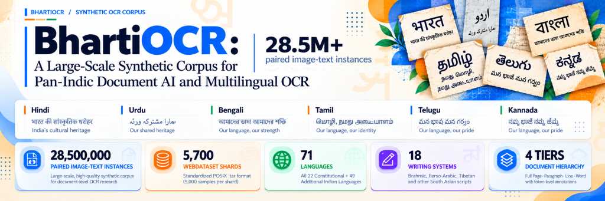
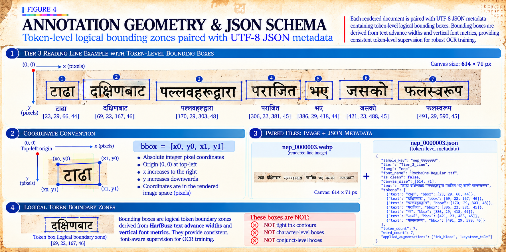

<div align="center">



<br/>

[](https://huggingface.co/datasets/Faizaniqbal/BhartiOCR)
[](#15-provenance--licensing)
[-f59e0b.svg)](https://github.com/webdataset/webdataset)
[](#13-webdataset-structure--streaming)
[](https://huggingface.co/datasets/Faizaniqbal/BhartiOCR)
[](https://huggingface.co/datasets/Faizaniqbal/BhartiOCR)
[](https://huggingface.co/datasets/Faizaniqbal/BhartiOCR)
[](https://huggingface.co/datasets/Faizaniqbal/BhartiOCR)

</div>

# BhartiOCR: A Large-Scale Synthetic Corpus for Pan-Indic Document AI and Multilingual OCR

**28,500,000 paired image-text instances · 71 languages · 18 writing systems · 5,700 WebDataset shards**

BhartiOCR is a large-scale, controlled synthetic OCR and document dataset spanning 71 South Asian languages and 18 writing systems, designed for multilingual OCR pretraining, fine-tuning, document recognition, layout research, and controlled robustness research. BhartiOCR contains **28,500,000 paired image-text instances** distributed across **5,700 standardized WebDataset POSIX `.tar` archives** (exactly 5,000 samples per shard). All records are encoded as WebP images (`quality=85`) paired with UTF-8 JSON metadata containing token-level or line-level logical bounding coordinates, font identifiers, structural tier tags, and recorded augmentation sequences.

**Access:** the dataset is available to researchers through an access request approved by the maintainer.

---

## 1. Overview

BhartiOCR provides a controlled, scalable synthetic corpus to train and evaluate vision-language backbones, sequence-to-sequence OCR models (e.g., TrOCR, CRNN), and document understanding architectures (e.g., Donut, Nougat, Florence-2) across the typographic and orthographic complexity of South Asian scripts.

Four structural tiers with token-level bounding coordinates in standard WebDataset format:
* **Linguistic Purity**: Unicode NFC text buffers screened against out-of-domain foreign stopwords and non-native scripts.
* **OpenType Complex Text Layout (CTL)**: Shaped via HarfBuzz (`uharfbuzz`) with explicit OpenType script and language tags, handling conjunct ligatures (*samyuktaksharas*), half-forms, reordering, and bidirectional text directionality (LTR Brahmic and RTL Extended Arabic).
* **FreeType Glyph Rasterization**: Rendered via FreeType with font-metric vertical padding to mitigate diacritic truncation across upper and lower extremities.
* **4 Structural Tiers**: Spanning isolated words/tokens (30%), single reading lines (55%), multi-line paragraph blocks (13%), and full-page broadsheet documents (2%).
* **Physical Degradation Library**: Samples are degraded using procedural paper substrates, ink capillary bleeding, bureaucratic stamps, creases, dust noise, contrast shifts, and optical distortions.
* **POSIX WebDataset Packaging**: Serialized into high-throughput `.tar` shards for direct HTTP streaming into training loops without local disk extraction.

---

## 2. Dataset Summary

| Property | Dataset Specification |
|---|---|
| **Dataset Name** | BhartiOCR |
| **Total Scale** | 28,500,000 paired image-text instances |
| **Archive Topology** | 5,700 WebDataset POSIX `.tar` archives (exactly 5,000 paired samples per shard) |
| **Language Coverage** | 71 South Asian languages (22 Eighth Schedule languages + 49 regional, tribal & classical languages) |
| **Writing Systems** | 18 distinct writing systems |
| **Fonts** | 143 font files from open-licence families in the inventory (1 quarantined) |
| **Structural Granularity** | 4 tiers: Full Page (2%), Paragraph (13%), Reading Line (55%), Word/Token (30%) |
| **Image Format** | WebP lossy encoding at `quality=85` (`.webp`) |
| **Annotation Format** | UTF-8 JSON (`.json`) with token-level or line-level logical bounding boxes `[x0, y0, x1, y1]` |
| **Clean and Degraded Samples** | Most samples are degraded. The clean share varies with the generator version, from almost none in some labels to about half in others |
| **Degradation System** | Registry of 54 operators. Not every generator version uses the full registry. Degraded samples usually pass through 3 to 5 operators, up to 6 in a few labels |
| **Shard File Naming** | 100% published as `{lang}_train_{shard:05d}.tar` (no separate physical `_val_` or `_test_` files) |
| **Partitions** | 5,092 training, 304 validation and 304 test shards, listed in `manifest/v1.0/splits.jsonl` |
| **Corpus Profiles** | 28 open-domain labels (15.0 M samples), 14 focused-vocabulary labels and 29 script-coverage labels (8.75 M samples) |
| **Reproducibility** | Pseudo-deterministic (seeded PRNG; preserves statistical structure across reruns) |
| **Primary Tasks** | Multilingual OCR, Document Layout Research, Token Localization Research, Controlled Robustness Evaluation |
| **Licensing** | Software & metadata: Apache-2.0; Fonts: SIL OFL 1.1 / GPL+FE / Apache-2.0; Upstream text: multi-license |

---

## 3. Why BhartiOCR Exists

Optical Character Recognition and Document Understanding models trained on Latin-script corpora or clean synthetic renders frequently fail when deployed on South Asian printed material. BhartiOCR targets three specific engineering bottlenecks:

### 3.1 Complex Text Layout (CTL) and Conjunct Integrity
Brahmic writing systems are alpha-syllabaries (abugidas) where consonants carry an inherent vowel that is modified by dependent vowel signs (*matras*). Consonant clusters combine through halants (viramas) into complex conjunct ligatures (*samyuktaksharas*), half-forms, or vertically stacked glyphs. Perso-Arabic scripts (Urdu, Kashmiri, Sindhi) require cursive, context-sensitive glyph shaping across initial, medial, final, and isolated positions, formatted in Nastaliq or Naskh typographic styles.

Standard rasterization tools (such as default PIL rendering) bypass OpenType GSUB/GPOS tables, producing disconnected graphemes, misplaced diacritics, or missing-glyph tofu boxes (`.notdef` Glyph ID 0). BhartiOCR routes all text buffers through `uharfbuzz` with explicit script tags, language specifiers, and bidirectional flags (`ltr` vs `rtl`).

### 3.2 Diacritic Containment and Vertical Zone Padding
Indic scripts feature vertical vowel signs, nasal markers (*anusvaras*), breath markers (*visargas*), and nuance dots (*nuktas*) placed above the headline (*shirorekha*) or below the base consonant. Standard bounding-box tight-cropping clips these extremities, leading to systematic character and conjunct substitution errors during visual recognition.

The rendering pipeline adds font-metric-derived vertical padding to reduce diacritic and glyph-extremity clipping:
> **Vertical padding:** the canvas extends `max(0.8, A) * s + 12` px above and `max(0.35, D) * s + 12` px below the baseline, where `s` is the font size and `A` and `D` are the font's ascender and descender in em units.
In an audit of 10,789 font and line pairs in 9 scripts, this padding clipped ink in at most 2.1% of lines in any script. A fixed em box clipped most lines in every script audited.

### 3.3 Realistic Non-Sterile Document Degradation
Standard synthetic datasets present clean black text on uniform white backgrounds. Real-world South Asian documents (newspapers, archival books, court filings, administrative circulars) exhibit thin newsprint pulp bleed, toner micro-voids, ink feathering, handling folds, bureaucratic rubber stamps, uneven illumination shadows, and camera perspective tilt.

BhartiOCR applies a multi-stage degradation pipeline combining procedural paper substrates, ink compositing, and physical/optical noise to narrow the domain gap between synthetic pretraining and physical document recognition.

---

## 4. Generation Pipeline

```
[Raw Upstream Text Corpora]
          │
          ▼
[Stage 1: Unicode NFC Normalization] ──> Preserves ZWJ (\u200D) & ZWNJ (\u200C)
          │
          ▼
[Stage 2: Linguistic Purity Gate] ────> Stopword exclusion & >=3 native script chars
          │
          ▼
[Stage 3: Font Selection & cmap Gate] ─> Font pool: at least 20 script code points
          │
          ▼
[Stage 4: HarfBuzz OpenType Shaping] ──> Script-tagged CTL, GSUB/GPOS, LTR/RTL
          │
          ▼
[Stage 5: FreeType Glyph Raster] ─────> Glyph bitmap rasterization & metric vertical padding
          │
          ▼
[Stage 6: Structural Tier Packaging] ──> 4 Tiers: Full Page, Paragraph, Line, Word
          │
          ▼
[Stage 7: Production Degradation] ────> Substrate, ink, optics, geometry (usually 3-5 operators)
          │
          ▼
[Stage 8: Integrity Assertions] ───────> Token check and glyph ID 0 guard
          │
          ▼
[Stage 9: Serialization] ─────────────> WebP (quality=85) + UTF-8 JSON
          │
          ▼
[Stage 10: POSIX Tar Packaging] ──────> 5,000 paired samples per shard
          │
          ▼
[Stage 11: SHA-256 Checksum] ─────────> Shard integrity verification
          │
          ▼
[Stage 12: Stream-and-Evict Hub Push] -> Background upload; stream-and-evict shard lifecycle
```

---

## 5. Language & Writing-System Coverage

BhartiOCR encompasses **71 South Asian languages** (22 Eighth Schedule languages + 49 regional, tribal & classical languages) spanning **18 distinct writing systems**:

### 5.1 Full 71-Language Master Inventory

| # | Language | ISO 639-3 | Script Family | Direction | Shards Live | Samples Live | Hub Directory |
| :-: | :--- | :---: | :--- | :---: | :---: | :---: | :--- |
| 1 | **Bengali** | `ben` | Bengali-Assamese (`Beng`) | LTR | 200 | 1,000,000 | `data/bengali/` |
| 2 | **Hindi** | `hin` | Devanagari (`Deva`) | LTR | 200 | 1,000,000 | `data/hindi/` |
| 3 | **Marathi** | `mar` | Devanagari (`Deva`) | LTR | 200 | 1,000,000 | `data/marathi/` |
| 4 | **Tamil** | `tam` | Tamil (`Taml`) | LTR | 200 | 1,000,000 | `data/tamil/` |
| 5 | **Urdu** | `urd` | Extended Arabic (`Arab`) | RTL | 200 | 1,000,000 | `data/urdu/` |
| 6 | **Angika** | `anp` | Devanagari (`Deva`) | LTR | 100 | 500,000 | `data/angika/` |
| 7 | **Assamese** | `asm` | Bengali-Assamese (`Beng`) | LTR | 100 | 500,000 | `data/assamese/` |
| 8 | **Awadhi** | `awa` | Devanagari (`Deva`) | LTR | 100 | 500,000 | `data/awadhi/` |
| 9 | **Bhojpuri** | `bho` | Devanagari (`Deva`) | LTR | 100 | 500,000 | `data/bhojpuri/` |
| 10 | **Bishnupriya Manipuri** | `bpy` | Bengali-Assamese (`Beng`) | LTR | 100 | 500,000 | `data/bishnupriya/` |
| 11 | **Bodo** | `brx` | Devanagari (`Deva`) | LTR | 100 | 500,000 | `data/bodo/` |
| 12 | **Braj Bhasha** | `bra` | Devanagari (`Deva`) | LTR | 100 | 500,000 | `data/brajbhasha/` |
| 13 | **Gondi** | `gon` | Devanagari (`Deva`) | LTR | 100 | 500,000 | `data/gondi/` |
| 14 | **Gujarati** | `guj` | Gujarati (`Gujr`) | LTR | 100 | 500,000 | `data/gujarati/` |
| 15 | **Haryanvi** | `bgc` | Devanagari (`Deva`) | LTR | 100 | 500,000 | `data/haryanvi/` |
| 16 | **Kannada** | `kan` | Kannada (`Knda`) | LTR | 100 | 500,000 | `data/kannada/` |
| 17 | **Kashmiri** | `kas` | Extended Arabic (`Arab`) | RTL | 100 | 500,000 | `data/kashmiri/` |
| 18 | **Malayalam** | `mal` | Malayalam (`Mlym`) | LTR | 100 | 500,000 | `data/malayalam/` |
| 19 | **Manipuri** | `mni` | Meetei Mayek (`Mtei`) | LTR | 100 | 500,000 | `data/manipuri/` |
| 20 | **Marwari** | `mwr` | Devanagari (`Deva`) | LTR | 100 | 500,000 | `data/marwari/` |
| 21 | **Nepali** | `nep` | Devanagari (`Deva`) | LTR | 100 | 500,000 | `data/nepali/` |
| 22 | **Newari (Nepal Bhasa)** | `new` | Devanagari (`Deva`) | LTR | 100 | 500,000 | `data/newari/` |
| 23 | **Odia** | `ori` | Odia (`Orya`) | LTR | 100 | 500,000 | `data/odia/` |
| 24 | **Pahari-Pothwari** | `phr` | Extended Arabic (`Arab`) | RTL | 100 | 500,000 | `data/pahari/` |
| 25 | **Punjabi** | `pan` | Gurmukhi (`Guru`) | LTR | 100 | 500,000 | `data/punjabi/` |
| 26 | **Rajasthani** | `raj` | Devanagari (`Deva`) | LTR | 100 | 500,000 | `data/rajasthani/` |
| 27 | **Sanskrit** | `san` | Devanagari (`Deva`) | LTR | 100 | 500,000 | `data/sanskrit/` |
| 28 | **Santali** | `sat` | Ol Chiki (`Olck`) | LTR | 100 | 500,000 | `data/santali/` |
| 29 | **Saraiki** | `skr` | Extended Arabic (`Arab`) | RTL | 100 | 500,000 | `data/saraiki/` |
| 30 | **Sindhi** | `snd` | Extended Arabic (`Arab`) | RTL | 100 | 500,000 | `data/sindhi/` |
| 31 | **Sinhala** | `sin` | Sinhala (`Sinh`) | LTR | 100 | 500,000 | `data/sinhala/` |
| 32 | **Telugu** | `tel` | Telugu (`Telu`) | LTR | 100 | 500,000 | `data/telugu/` |
| 33 | **Tulu** | `tcy` | Kannada (`Knda`) | LTR | 100 | 500,000 | `data/tulu/` |
| 34 | **Angami Naga** | `njm` | Latin (`Latn`) | LTR | 50 | 250,000 | `data/angami_naga/` |
| 35 | **Ao Naga** | `njo` | Latin (`Latn`) | LTR | 50 | 250,000 | `data/ao_naga/` |
| 36 | **Badaga** | `bfq` | Tamil (`Taml`) | LTR | 50 | 250,000 | `data/badaga/` |
| 37 | **Bagheli** | `bfy` | Devanagari (`Deva`) | LTR | 50 | 250,000 | `data/bagheli/` |
| 38 | **Balti** | `bft` | Extended Arabic (`Arab`) | RTL | 50 | 250,000 | `data/balti/` |
| 39 | **Bhili** | `bhb` | Devanagari (`Deva`) | LTR | 50 | 250,000 | `data/bhili/` |
| 40 | **Bundeli** | `bns` | Devanagari (`Deva`) | LTR | 50 | 250,000 | `data/bundeli/` |
| 41 | **Chakma** | `ccp` | Chakma (`Cakm`) | LTR | 50 | 250,000 | `data/chakma/` |
| 42 | **Chhattisgarhi** | `hne` | Devanagari (`Deva`) | LTR | 50 | 250,000 | `data/chhattisgarhi/` |
| 43 | **Dogri** | `doi` | Devanagari (`Deva`) | LTR | 50 | 250,000 | `data/dogri/` |
| 44 | **Doteli** | `dty` | Devanagari (`Deva`) | LTR | 50 | 250,000 | `data/doteli/` |
| 45 | **Garhwali** | `gbm` | Devanagari (`Deva`) | LTR | 50 | 250,000 | `data/garhwali/` |
| 46 | **Garo** | `grt` | Latin (`Latn`) | LTR | 50 | 250,000 | `data/garo/` |
| 47 | **Gojri** | `gju` | Extended Arabic (`Arab`) | RTL | 50 | 250,000 | `data/gojri/` |
| 48 | **Ho** | `hoc` | Devanagari (`Deva`) | LTR | 50 | 250,000 | `data/ho/` |
| 49 | **Karbi** | `mjw` | Latin (`Latn`) | LTR | 50 | 250,000 | `data/karbi/` |
| 50 | **Kharia** | `khr` | Devanagari (`Deva`) | LTR | 50 | 250,000 | `data/kharia/` |
| 51 | **Khasi** | `kha` | Latin (`Latn`) | LTR | 50 | 250,000 | `data/khasi/` |
| 52 | **Kodava** | `kfa` | Kannada (`Knda`) | LTR | 50 | 250,000 | `data/kodava/` |
| 53 | **Kokborok** | `trp` | Bengali-Assamese (`Beng`) | LTR | 50 | 250,000 | `data/kokborok/` |
| 54 | **Konkani** | `gom` | Devanagari (`Deva`) | LTR | 50 | 250,000 | `data/konkani/` |
| 55 | **Konyak Naga** | `nbe` | Latin (`Latn`) | LTR | 50 | 250,000 | `data/konyak_naga/` |
| 56 | **Kui** | `kxu` | Odia (`Orya`) | LTR | 50 | 250,000 | `data/kui/` |
| 57 | **Kumaoni** | `kfy` | Devanagari (`Deva`) | LTR | 50 | 250,000 | `data/kumaoni/` |
| 58 | **Kurukh (Oraon)** | `kru` | Devanagari (`Deva`) | LTR | 50 | 250,000 | `data/kurukh/` |
| 59 | **Lepcha** | `lep` | Lepcha (`Lepc`) | LTR | 50 | 250,000 | `data/lepcha/` |
| 60 | **Limbu** | `lif` | Sirijanga (Limbu) (`Limb`) | LTR | 50 | 250,000 | `data/limbu/` |
| 61 | **Lotha Naga** | `njh` | Latin (`Latn`) | LTR | 50 | 250,000 | `data/lotha_naga/` |
| 62 | **Magahi** | `mag` | Devanagari (`Deva`) | LTR | 50 | 250,000 | `data/magahi/` |
| 63 | **Maithili** | `mai` | Devanagari (`Deva`) | LTR | 50 | 250,000 | `data/maithili/` |
| 64 | **Malvi** | `mup` | Devanagari (`Deva`) | LTR | 50 | 250,000 | `data/malvi/` |
| 65 | **Mizo** | `lus` | Latin (`Latn`) | LTR | 50 | 250,000 | `data/mizo/` |
| 66 | **Mundari** | `unr` | Devanagari (`Deva`) | LTR | 50 | 250,000 | `data/mundari/` |
| 67 | **Pali** | `pli` | Devanagari (`Deva`) | LTR | 50 | 250,000 | `data/pali/` |
| 68 | **Prakrit** | `pra` | Devanagari (`Deva`) | LTR | 50 | 250,000 | `data/prakrit/` |
| 69 | **Shina** | `scl` | Extended Arabic (`Arab`) | RTL | 50 | 250,000 | `data/shina/` |
| 70 | **Tibetan** | `bod` | Tibetan (`Tibt`) | LTR | 50 | 250,000 | `data/tibetan/` |
| 71 | **Western Punjabi (Shahmukhi)** | `pnb` | Extended Arabic (`Arab`) | RTL | 50 | 250,000 | `data/western_punjabi/` |
| **Total** | **71 Languages** | | **18 Writing Systems** | | **5,700** | **28,500,000** | |

### 5.2 Authoritative Writing System Aggregation

| Writing System | Script Code | Direction | Associated Languages | Shards | Total Samples |
| :--- | :---: | :---: | :--- | :---: | :---: |
| **Devanagari** | `Deva` | LTR | Angika, Awadhi, Bagheli, Bhili, Bhojpuri, Bodo, Braj Bhasha, Bundeli, Chhattisgarhi, Dogri, Doteli, Garhwali, Gondi, Haryanvi, Hindi, Ho, Kharia, Konkani, Kumaoni, Kurukh (Oraon), Magahi, Maithili, Malvi, Marathi, Marwari, Mundari, Nepali, Newari (Nepal Bhasa), Pali, Prakrit, Rajasthani, Sanskrit (32 languages) | 2,500 | 12,500,000 |
| **Extended Arabic** | `Arab` | RTL | Balti, Gojri, Kashmiri, Pahari-Pothwari, Saraiki, Shina, Sindhi, Urdu, Western Punjabi (Shahmukhi) (9 languages) | 800 | 4,000,000 |
| **Bengali-Assamese** | `Beng` | LTR | Assamese, Bengali, Bishnupriya Manipuri, Kokborok (4 languages) | 450 | 2,250,000 |
| **Latin** | `Latn` | LTR | Angami Naga, Ao Naga, Garo, Karbi, Khasi, Konyak Naga, Lotha Naga, Mizo (8 languages) | 400 | 2,000,000 |
| **Tamil** | `Taml` | LTR | Badaga, Tamil (2 languages) | 250 | 1,250,000 |
| **Kannada** | `Knda` | LTR | Kannada, Kodava, Tulu (3 languages) | 250 | 1,250,000 |
| **Odia** | `Orya` | LTR | Kui, Odia (2 languages) | 150 | 750,000 |
| **Gujarati** | `Gujr` | LTR | Gujarati (1 language) | 100 | 500,000 |
| **Malayalam** | `Mlym` | LTR | Malayalam (1 language) | 100 | 500,000 |
| **Meetei Mayek** | `Mtei` | LTR | Manipuri (1 language) | 100 | 500,000 |
| **Gurmukhi** | `Guru` | LTR | Punjabi (1 language) | 100 | 500,000 |
| **Ol Chiki** | `Olck` | LTR | Santali (1 language) | 100 | 500,000 |
| **Sinhala** | `Sinh` | LTR | Sinhala (1 language) | 100 | 500,000 |
| **Telugu** | `Telu` | LTR | Telugu (1 language) | 100 | 500,000 |
| **Chakma** | `Cakm` | LTR | Chakma (1 language) | 50 | 250,000 |
| **Lepcha** | `Lepc` | LTR | Lepcha (1 language) | 50 | 250,000 |
| **Sirijanga (Limbu)** | `Limb` | LTR | Limbu (1 language) | 50 | 250,000 |
| **Tibetan** | `Tibt` | LTR | Tibetan (1 language) | 50 | 250,000 |
| **Total** | | | **18 Writing Systems (71 Languages)** | **5,700** | **28,500,000** |

---

## 6. Four Structural Tiers

Every 5,000-sample WebDataset shard is composed across four document structural tiers to support diverse OCR and document-AI modeling tasks:

| Tier | Granularity | Volume Share | Total Samples Live | Typical Canvas Dimensions | Word Count | Target Modeling Focus |
|---|---|:---:|---:|:---:|:---:|---|
| **Tier 1** | Full-Page Documents | 2.0% | 570,000 | 1000 x 1350 px | 80-350 | Multi-column reading order, document layout research, table/spread parsing |
| **Tier 2** | Paragraph Blocks | 13.0% | 3,705,000 | Max width 700 px (variable height) | 25-80 | Multi-line text block recognition, wrapped paragraph reading order |
| **Tier 3** | Reading Lines | 55.0% | 15,675,000 | Variable width x dynamic metric height | 4-18 | Sequence-to-sequence line recognition (TrOCR, CRNN), CTC loss |
| **Tier 4** | Words / Tokens | 30.0% | 8,550,000 | Word advance width x dynamic metric height | 1-3 | Word/token recognition, vocabulary coverage, and complex-conjunct examples |
| **Total** | | **100.0%** | **28,500,000** | | | |

* **Tier 1 (Full-Page Spreads):** Rendered on fixed 1000 × 1350 px canvases simulating archival documents, government gazettes, and daily broadsheets with headers, horizontal column rules, and multi-block paragraphs.
* **Tier 2 (Paragraph Blocks):** Formatted text blocks wrapped to a maximum width of 700 pixels with uniform line leading and font sizes (20–28 pt).
* **Tier 3 (Reading Lines):** Continuous syntactic lines, poetry verses, and headlines with font sizes ranging from 26 to 38 pt.
* **Tier 4 (Words and Isolated Tokens):** Isolated lexical items, compound words, numerals, and complex conjuncts (32–44 pt). Annotations provide word/token-level boundary coordinates.

---

## 7. Rendering & Complex Text Layout

Text rendering is implemented in Python via `uharfbuzz` and `freetype-py`:

1. **Unicode NFC & Joiner Retention**: Ingested text is normalized to Unicode NFC via `unicodedata.normalize('NFC', text)`. Zero-Width Joiner (`\u200D` / ZWJ) and Zero-Width Non-Joiner (`\u200C` / ZWNJ) codepoints are strictly preserved to maintain authentic half-consonant forms (e.g., Hindi *हल्*) and ligature suppression.
2. **HarfBuzz Buffer Configuration**: For each text line, an empty `uharfbuzz.Buffer` is initialized, assigned the target ISO 15924 script tag (`Deva`, `Beng`, `Taml`, `Arab`, `Mtei`, `Olck`, etc.), ISO 639-3 language specifier, and directional mode (`ltr` for Brahmic scripts; `rtl` for Extended Arabic).
3. **OpenType Feature Shaping**: `uharfbuzz.shape(hb_font, hb_buffer)` executes OpenType `GSUB` (glyph substitution) and `GPOS` (glyph positioning) rules, producing output glyph IDs, cluster associations, advance widths (`x_advance`), and positional offsets (`x_offset`, `y_offset`).
4. **FreeType Glyph Rasterization**: Glyph IDs are loaded via `freetype.Face.load_glyph(gid, FT_LOAD_RENDER | FT_LOAD_NO_HINTING)` to rasterize 8-bit anti-aliased alpha bitmaps. Bitmaps are blitted onto a grayscale NumPy canvas using cumulative cursor positions.
5. **Bidirectional Cursor Tracking**: For LTR scripts, the horizontal pen cursor advances by `x_advance // 64`. For RTL scripts (`urd`, `kas`, `snd`), the cursor begins at `canvas_width - padding` and decrements by `x_advance // 64`.
6. **Canvas Compositing**: Pillow (`PIL.Image`) wraps the rendered NumPy array for subsequent paper-physics blending and format serialization.

---

## 8. Font Validation & Typography

The font inventory lists **143 font files from open-licence families**, organized across language and script directories:

* **Font Verification Gate**: A font enters the pool for a script only if its `cmap` holds at least 20 code points of that script. Depending on the generator version, characters missing from the chosen font are removed before shaping, skipped when drawing, or stop the run if a logged glyph has ID 0.
* **Quarantine Policy**: Fonts that fail minimum script codepoint thresholds (fewer than 20 target script codepoints in `cmap`) or generate invalid metrics are isolated in `fonts/quarantine_broken_fonts/` (1 font currently quarantined).
* **Script Allocation**: High-resource scripts (Devanagari, Bengali, Tamil, Extended Arabic) utilize diverse font pools spanning classical serif, modern sans-serif, and display typefaces. Scripts with smaller open-source typography ecosystems (Ol Chiki, Meetei Mayek) utilize verified authoritative typefaces (e.g., Noto Sans Ol Chiki, Noto Sans Meetei Mayek).

---

## 9. Annotation Schema & Geometry

Each sample within a WebDataset archive consists of a WebP image (`.webp`) and a paired UTF-8 JSON metadata record (`.json`).

<div align="center">

<p><em>Token-level geometry specification and paired JSON metadata schema.</em></p>
</div>

The example below shows the most common layout. Metadata keys differ between generator versions (at least 5 key schemas exist), so read each record defensively. `schema/v1.0/sample_schema.json` describes the fields.

### 9.1 JSON Schema Example (Tier 3 Reading Line)

```json
{
  "sample_key": "nep_0000003",
  "tier": "Tier_3_Line",
  "lang": "nep",
  "font_name": "RozhaOne-Regular.ttf",
  "is_clean": false,
  "canvas_size": [614, 71],
  "text": "टाढा दक्षिणबाट पल्लवहरूद्वारा पराजित भए जसको फलस्वरूप",
  "tokens": [
    {
      "text": "टाढा",
      "bbox": [23, 29, 66, 44]
    },
    {
      "text": "दक्षिणबाट",
      "bbox": [69, 22, 167, 46]
    },
    {
      "text": "पल्लवहरूद्वारा",
      "bbox": [170, 29, 303, 48]
    },
    {
      "text": "पराजित",
      "bbox": [306, 22, 381, 45]
    },
    {
      "text": "भए",
      "bbox": [386, 29, 418, 44]
    },
    {
      "text": "जसको",
      "bbox": [421, 23, 488, 45]
    },
    {
      "text": "फलस्वरूप",
      "bbox": [491, 29, 590, 45]
    }
  ],
  "token_count": 7,
  "word_count": 7,
  "applied_augmentations": [
    "#02 Substrate: aged_paper",
    "#19 Mobile JPEG",
    "#21 Diagonal Fold",
    "#40 Keystone Tilt",
    "#15 Shadow Gradient"
  ]
}
```

### 9.2 Field Definitions

| Field Name | Type | Description |
|---|:---:|---|
| `sample_key` | `string` | Unique identifier formatted as `{lang}_{global_idx:07d}` (e.g., `kan_0008644`). |
| `tier` | `string` | Structural tier: `Tier_1_FullPage`, `Tier_2_Paragraph`, `Tier_3_Line`, `Tier_4_Word`. |
| `lang` | `string` | ISO 639-3 three-letter language identifier. |
| `font_name` | `string` | Base filename of the font file utilized during shaping and rendering. |
| `is_clean` | `boolean` | Flag indicating whether the instance is an undegraded control sample. |
| `canvas_size` | `[int, int]` | Canvas dimensions `[width, height]` in pixels. |
| `text` | `string` | Ground truth text transcription in normalized Unicode NFC. |
| `tokens` | `list[dict]` | Token-level annotations containing token `text` and bounding coordinates `bbox`. |
| `token_count` | `int` | Total number of annotated tokens in the instance. |
| `word_count` | `int` | Count of whitespace-delimited words in the input text buffer. |
| `applied_augmentations` | `list[string]` | Ordered list of physical degradation operations applied to the instance. |
| `shaped_glyphs` | `list[dict]` | Optional trace, not stored in every shard, of shaped OpenType glyph IDs and cluster indices (first 30 glyphs). |

### 9.3 Bounding Box Semantics

* **Format**: Bounding boxes are formatted as `[x0, y0, x1, y1]` in absolute integer pixel coordinates with origin `(0, 0)` at the top-left corner.
* **Semantic Definition**: Bounding boxes represent **logical token boundary zones derived from text advance widths and vertical font metrics**, computed as:
  ```text
x0 = cursor position,  x1 = cursor position + token advance width
y0 = baseline - ascender height + 4,  y1 = baseline + descender depth - 4
```
* **Important Caveat**: Bounding boxes represent logical word/token layout cells based on HarfBuzz advance metrics. They are **not** tight pixel-level connected-component ink contours, nor are they character-level or conjunct-level bounding boxes.

---

## 10. Degradation System

BhartiOCR maintains a distinction between its **comprehensive reference library** and its **active cloud production runner configuration**:

### 10.1 Reference 54-Operator Library
BhartiOCR documents a comprehensive reference library of 54 procedural degradation operators detailed in [`AUGMENTATION_REGISTRY.md`](AUGMENTATION_REGISTRY.md), categorized into five functional domains:
* **Category A: Procedural Substrates (12 operators)**: Simulates diverse paper stocks, age-induced acid toning, pulp grain, moisture stains, notebook rulings, and formal stationery.
* **Category B: Physical Degradation Operators (14 operators)**: Models mechanical handling wear, ink capillary bleeding, toner erosion, photostat clipping, folds, carbon dye, and bureaucratic stamps.
* **Category C: Historical Manuscript Decay (11 operators)**: Captures archival aging phenomena including wormholes, craquelure, iron gall acid corrosion, fungal foxing, and margin embrittlement.
* **Category D: Geometric, Optical & Sensor Distortions (11 operators)**: Replicates capture artifacts including perspective tilt, optical defocus, sensor noise, dynamic range extremes, and compression loss.
* **Category E: Handwriting Kinematic Deformations (6 operators)**: Implements synthetic handwriting dynamics, stroke pressure modulation, slant, and elastic deformation models.

*For full mathematical specifications, implementation parameters, and visual examples of all 54 operators, see [`AUGMENTATION_REGISTRY.md`](AUGMENTATION_REGISTRY.md).*

### 10.2 Active Production Runner Configuration
To sustain cloud throughput on CPU workers while preventing unreadable text corruption, generator versions used subsets of this library. The main production runner (`indicpixel_kaggle_production_pipeline.py`) used:
* **Procedural Substrates**: 1 of 12 procedural paper substrates selected uniformly at random (`clean_white`, `aged_paper`, `book_page`, `newspaper`, `ruled_notebook`, `parchment`, `weathered`, `coffee_stained`, `old_book`, `recycled_kraft`, `cream`, `ivory`).
* **Ink Bleed Composite**: Simulated capillary ink bleed composited directly onto the procedural substrate.
* **Stochastic Transforms**: 2 to 4 transforms drawn from the active pool:
  * `#26 Bureaucratic Stamp` (semi-transparent colored seals)
  * `#15 Non-Uniform Shadow` (linear illumination gradients)
  * `#20/#21 Paper Crease / Diagonal Fold` (3D fold shadows)
  * `#47 Dust / Sensor Noise` (Gaussian normal noise)
  * `#40 Keystone Tilt` (affine rotation within ±1.0°)
  * `#44/#45 High / Low Contrast` (dynamic range scaling)
  * `#19 Mobile JPEG Compression` (quality factor 68–85)

### 10.3 Clean vs Degraded Balance
* **Clean Samples**: The clean share varies with the generator version, from almost none in some labels to about half in others. See the `is_clean` field or the applied operators in each record.
* **Degraded Samples**: Usually pass through 3 to 5 operators, and up to 6 in a few labels. The applied operators are stored in the metadata, so samples can be filtered or re-weighted.

---

## 11. Quality Assurance

The synthesis pipeline implements automated validation gates at generation time and periodic forensic audits:

### 11.1 Automated Production Gates
* **Unicode Normalization Gate**: Text buffers undergo NFC normalization; unmapped control characters and broken surrogate pairs are discarded.
* **Native Script Character Gate**: Every candidate string must contain at least 3 alphabetical characters within the target script's Unicode block, rejecting punctuation-only noise strings (e.g., `,,,`).
* **Language-Specific Contamination Filters**: Ingested text is checked against language-specific exclusion lexicons to prevent cross-language stopword leakage (e.g., filtering out Hindi stopwords when synthesizing Bodo or Maithili).
* **Font Coverage Check**: Every font is checked per script. Some generator versions also check every line, and others remove or skip uncovered characters.
* **Glyph ID 0 Guard**: The generator guards against `.notdef` glyphs. In an audit, none of the 846,310 glyph records logged in five Brahmic shards used glyph ID 0. Shards without a glyph log could not be checked this way.
* **Non-Empty Token Assertion**: Every instance must contain at least one valid token (`assert meta["token_count"] > 0`).
* **Checksum Verification**: Cloud workers verify local `.tar` shard integrity and calculate SHA-256 digests prior to uploading.

### 11.2 Offline Forensic Auditing Tools
* **5,000-Sample Cloud Smoke Tests**: Executed in isolated environments prior to deploying full-scale production fleets for newly integrated languages.
* **Visual Inspection Plates**: Forensic multi-tier broadsheets generated to visually inspect conjunct formation, matra placement, and background substrate realism.
* **Diacritic Ownership Gate**: An offline reference verification tool used to verify ink pixel containment within token bounding envelopes. (Note: Diacritic ownership verification is run as an offline forensic tool rather than an inline per-sample check inside the cloud production runner).

---

## 12. Downstream OCR Evaluation

We fine-tuned the EasyOCR ResNet-BiLSTM-CTC recogniser on only 2,000 BhartiOCR line and word images (three seeds) and tested it on real printed text blocks from the **Sarvam Indic OCR Bench** (`sarvamai/indic-ocr-bench`). None of its images were used for training. Scores are character error rates (CER) from the benchmark's official scorer on its test split.

| Script | Stock CER | After BhartiOCR | Error reduction |
|---|:---:|:---:|:---:|
| Meetei Mayek (new recogniser) | 0.916 | **0.335** | **63%** |
| Gurmukhi (new recogniser) | 0.900 | **0.344** | **62%** |
| Malayalam (new recogniser) | 0.920 | **0.543** | **41%** |
| Gujarati (new recogniser) | 0.823 | **0.557** | **32%** |
| Odia (new recogniser) | 0.863 | **0.611** | **29%** |
| Tamil* | 0.530 | **0.336** | **37%** |
| Assamese | 0.230 | **0.153** | **34%** |
| Urdu | 0.310 | **0.224** | **28%** |

*Part of the Tamil gain comes from vowel signs added to the output layer.

EasyOCR has no recogniser for the five new scripts, so they start from its Devanagari model, and their mean CER falls from 0.884 to 0.478. Ablations with identical text and fonts show that correct shaping and realistic degradation each lower the error. Ol Chiki, Bengali and Kashmiri gain 3 to 4%, and Devanagari recognisers show little or no gain. Sindhi is not evaluated, because the benchmark writes it in Devanagari while BhartiOCR's Sindhi is Perso-Arabic.

---

## 13. WebDataset Structure & Streaming

BhartiOCR archives use the POSIX WebDataset `.tar` format. Each sample shares a common key prefix:
* `{sample_key}.webp`: WebP encoded image (`quality=85`)
* `{sample_key}.json`: UTF-8 JSON metadata record

### 13.1 Shard Organization on Hugging Face Hub

All 5,700 WebDataset archives are partitioned by language into subdirectories under `data/{language}/` (see [Section 5.1](#51-full-71-language-master-inventory) for individual directory mappings). Within each language directory, shards follow the standard naming convention:

```
data/{language}/{lang}_train_{shard:05d}.tar
```

Each shard contains exactly 5,000 paired `.webp` and `.json` instances (e.g., `data/kannada/kan_train_00000.tar` contains samples `kan_0000000` through `kan_0004999`).

### 13.2 Direct HTTP Streaming Example (PyTorch + WebDataset)

The dataset is gated, so request access first and send your Hugging Face token with each request.

```python
import json
import webdataset as wds
from torch.utils.data import DataLoader

# Define shard URL pattern (e.g., Kannada shards on Hugging Face Hub)
shard_url = "https://huggingface.co/datasets/Faizaniqbal/BhartiOCR/resolve/main/data/kannada/kan_train_{00000..00099}.tar"

# Stream shards over HTTP without downloading the full dataset
dataset = (
    wds.WebDataset(shard_url, shardshuffle=True, resampled=False)
    .shuffle(1000)
    .decode("pil")
    .to_tuple("webp", "json")
)

dataloader = DataLoader(dataset, batch_size=32, num_workers=4)

for images, json_bytes_or_dicts in dataloader:
    # images: list of PIL Images
    # json_bytes_or_dicts: paired metadata records with text and bboxes
    for img, meta in zip(images, json_bytes_or_dicts):
        if isinstance(meta, (bytes, str)):
            meta = json.loads(meta)
        print(f"Sample: {meta['sample_key']}, Lang: {meta['lang']}, Tier: {meta['tier']}")
        print(f"Text: {meta['text']}")
        print(f"Tokens: {len(meta['tokens'])}, Canvas: {meta['canvas_size']}")
    break
```

---

## 14. Recommended Dataset Splitting

All 5,700 shards published on the Hugging Face Hub carry `_train_` filenames (e.g., `hin_train_00000.tar` through `hin_train_00199.tar`). There are currently **no separate physical validation or test archives** published on the Hub.

The official partition is listed in `manifest/v1.0/splits.jsonl` (5,092 training, 304 validation and 304 test shards). It follows the shard slices below, so keep these shards apart in any evaluation:

### 14.1 Deterministic Shard Slicing Guide (~90% Train / ~5% Validation / ~5% Test)

| Language Allocation | Total Shards | Train Partition | Validation Partition | Test Partition |
|---|:---:|---|---|---|
| **200-Shard Languages** (`hin, mar, urd, ben, tam`, 5 languages) | 200 | Shards `00000..00179` (180 shards, 900K, 90%) | Shards `00180..00189` (10 shards, 50K, 5%) | Shards `00190..00199` (10 shards, 50K, 5%) |
| **100-Shard Languages** (28 languages) | 100 | Shards `00000..00089` (90 shards, 450K, 90%) | Shards `00090..00094` (5 shards, 25K, 5%) | Shards `00095..00099` (5 shards, 25K, 5%) |
| **50-Shard Languages** (38 languages) | 50 | Shards `00000..00043` (44 shards, 220K, 88%) | Shards `00044..00046` (3 shards, 15K, 6%) | Shards `00047..00049` (3 shards, 15K, 6%) |

*(Note: For 50-shard languages, integer shard quantization yields an approximate 88% train / 6% validation / 6% test partition).*

* **Leakage Considerations**: Because upstream source texts were partitioned sequentially into shards, researchers requiring strictly leak-free linguistic evaluation sets should apply document-level deduplication or hash-based text filtering across split boundaries.

---

## 15. Provenance & Licensing

BhartiOCR incorporates multiple components with distinct licensing conditions:

### 15.1 License Framework

| Component | Source / Typology | Governing License | Terms & Notes |
|---|---|:---:|---|
| **Pipeline Code & Orchestration** | BhartiOCR Engine | **Apache-2.0** | Permissive open-source; modification and distribution permitted. |
| **Metadata & Annotations** | BhartiOCR Annotation Schema | **Apache-2.0** | Token bounding boxes and pipeline metadata released under Apache-2.0. |
| **Typography & Fonts** | Open-source typefoundries | **SIL OFL 1.1 / Apache-2.0 / GPL+FE** | Permissive open-source font licenses allowing embedding and bundling. |
| **Upstream Text (Wikipedia, FLORES-200)** | Open text corpora | **CC BY-SA** | Attribution; ShareAlike terms carry over to derived transcriptions. |
| **Upstream Text (Tatoeba)** | Indic portion of Tatoeba | **CC BY** | Attribution required. |
| **Upstream Text (GlotCC)** | GlotCC web corpus | **CC0** | No conditions. |
| **Upstream Text (Bodo)** | Bodo monolingual corpus | **MIT** | Keep the licence notice. |
| **Upstream Text (Dogri, Konkani)** | Machine-translated instruction data | **CC BY-NC** | Non-commercial terms apply to these two subsets. |
| **Curated Sentence Banks** | Languages without an adequate open corpus | **See dataset terms** | Lines composed from curated banks. |

### 15.2 Licensing and Commercial Compliance Notice
* **License Differentiation**: While the synthesis codebase and generated metadata are licensed under Apache-2.0, the underlying text comes from several corpora. The Dogri and Konkani subsets carry non-commercial terms (CC BY-NC).
* **Downstream Responsibility**: BhartiOCR makes no legal assertion that synthetic rendering or rasterization eliminates upstream copyright or licensing restrictions. Downstream users intending to utilize trained models in commercial settings must independently review upstream corpus terms and, where necessary, filter out the affected subsets.
* **Hugging Face Hub Metadata**: Categorized under `license: other` to reflect this multi-tier licensing framework.

---

## 16. Reproducibility

* **Deterministic Framing**: The dataset generation is **pseudo-deterministic**.
* **Seed Configuration**: The pipeline initializes Python `random.seed(42)` and NumPy `np.random.seed(42)` at worker start.
* **Reproducibility Scope**: Parallel worker pools execute independent shard tasks without per-sample PRNG re-anchoring. Consequently, re-running generation produces statistically and structurally consistent datasets (identical tier distributions, font allocations, and degradation categories), but individual rendered pixel arrays are not guaranteed to be bitwise pixel-identical.
* **Environment**: Built using Python 3.10–3.12 with `uharfbuzz==0.39.3`, `freetype-py==2.4.0`, `Pillow>=10.0.0`, `opencv-python>=4.8.0`, and `fonttools>=4.42.0`.

---

## 17. Limitations

Researchers and practitioners should consider the following technical boundaries:

1. **Synthetic Document Nature**: Although the degradation engine simulates paper fibers, ink bleeding, and photographic noise, synthetic images cannot reproduce all idiosyncratic physical anomalies found in natural historical manuscripts (e.g., uneven hand-carved woodblocks, physical water submersion, parchment buckling).
2. **Lossy WebP Compression**: Images are encoded as WebP with `quality=85`. They are not lossless rasters. High-frequency pixel noise undergoes mild lossy compression.
3. **Advance-Width Bounding Boxes**: Serialized bounding boxes `[x0, y0, x1, y1]` are logical token bounding cells derived from HarfBuzz cumulative advance widths and font metric vertical bounds. They do not represent tight connected-component ink contours, character-level boxes, or conjunct-level boxes.
4. **Transform/Geometry Invariance Limitation**: The degradation function `apply_micro_tilt()` applies small affine rotations (±1.0°) to image rasters without recomputing serialized bounding box coordinates. Bounding boxes in micro-tilted samples retain their pre-rotation coordinates.
5. **File Names of Partitions**: All 5,700 shards are published with `_train_` filenames on the Hub. Use `manifest/v1.0/splits.jsonl` to separate the training, validation and test shards.
6. **Degradation Library vs. Generator Versions**: The registry documents 54 operators, and not every generator version uses all of them.
7. **Linguistic Corpus Boundaries**: Most text comes from Wikipedia, with Tatoeba, GlotCC and FLORES-200 for some labels. Modern colloquial slang, conversational chat acronyms, and non-standard orthography may be underrepresented. The 29 script-coverage labels are built from small sentence banks, so use them for glyph and script learning rather than language modelling.
8. **Known Issues Measured in the Audit**:
   * Page samples without a transcription: all pages seen in `hin`, `bho`, `gom` and `mai`, and 34% in `urd`.
   * Invalid mark sequences in Lepcha: 38 of 88 distinct lines.
   * Overlapping word boxes: 33% of word pairs in `ben` and 36% in `san`.
   * No glyph log in shards such as Urdu, Kashmiri, Gondi, Khasi and Lepcha.
   * Nastaliq fonts in 26% of Urdu samples; the others are Naskh or Kufi.
   * Few fonts in some subsets: 2 in Bodo and 4 in Nepali.
   * Font coverage is checked per script, and per line only in some generator versions, so a rare character can be missing from an image while present in its transcription. How often this happens has not been measured.

---

## 18. Intended Uses

### 18.1 Supported Research & Modeling Use Cases
* **Multilingual OCR Pretraining**: Large-scale visual pretraining for encoder-decoder models (TrOCR, CRNN, Donut, Nougat, Florence-2, Qwen2-VL) across South Asian writing systems.
* **Document Layout & Reading-Order Research**: Intended research exploring layout parsing, multi-column reading order, and block decomposition on broadsheets (Tier 1) and paragraphs (Tier 2). Serialized annotations reflect logical token layout zones rather than semantic segmentation masks or dedicated layout-benchmark labels.
* **Token Localization Research**: Exploring token boundary detection, reading-line baseline tracking, and word-level localization. Bounding boxes are derived from HarfBuzz advances and font metrics rather than tight polygon ink ground truth.
* **Controlled Robustness Research**: Evaluating model resilience against ink bleed, paper discoloration, stamps, and sensor noise under controlled parameter sweeps.
* **Transfer Learning & Fine-Tuning**: Adapting pre-trained recognisers to South Asian scripts, especially scripts without a recogniser (e.g., Meetei Mayek, Gurmukhi, Malayalam, Gujarati, Odia). We recommend open-domain labels for language-level training and script-coverage labels for glyph coverage.

### 18.2 Out-of-Scope Uses
* Evaluating real-world OCR performance solely against synthetic metrics without evaluating on naturally scanned document collections.
* Automated extraction of legal, clinical, or identity data without human verification.
* Demographic, religious, or identity profiling based on synthetic text contents.
* Training machine translation systems evaluated on FLORES-200 with the Magahi and Chhattisgarhi subsets, which may contain its `devtest` sentences.

---

## 19. Citation

If you use BhartiOCR in your research, please cite:

```bibtex
@dataset{bhartiocr_2026,
  author       = {Faizan Iqbal},
  title        = {BhartiOCR: A Large-Scale Synthetic Corpus for Pan-Indic Document AI and Multilingual OCR},
  year         = {2026},
  publisher    = {Hugging Face},
  url          = {https://huggingface.co/datasets/Faizaniqbal/BhartiOCR}
}
```

---

## 20. Dataset Maintenance & Inquiries

BhartiOCR is actively maintained by Faizan Iqbal.

* **Repository Inquiries & Issues**: For questions regarding shard integrity, script support, or annotations, please open a discussion on the [Hugging Face Discussion Board](https://huggingface.co/datasets/Faizaniqbal/BhartiOCR/discussions).
* **Author / Maintainer**: Faizan Iqbal ([@Faizaniqbal](https://huggingface.co/Faizaniqbal))

